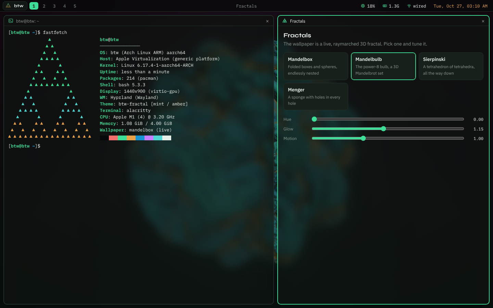
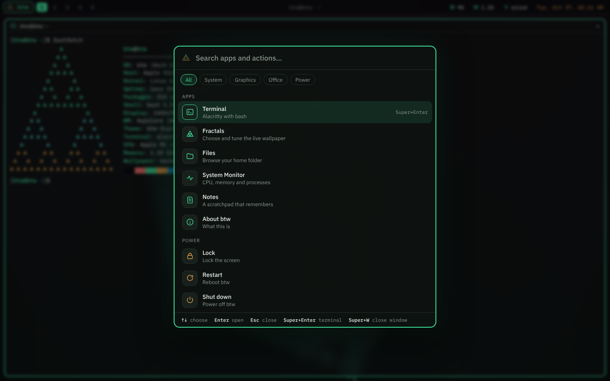

<h1 align="center">btw</h1>

<p align="center">
  <a href="https://github.com/noisyloop/btw/releases/latest"></a>
  
  
  
</p>

<p align="center"><b>A fractal-themed Linux desktop you can try on a Mac, on Windows, or on your Arch Linux.</b><br>
A native macOS launcher on Apple silicon, one PowerShell command on Windows, one command on Arch and Omarchy.</p>

<p align="center"><a href="https://github.com/noisyloop/btw/releases/latest/download/btw-macos.dmg"><b>Download for Mac</b></a> · <a href="https://github.com/noisyloop/btw/releases/latest/download/btw-factory.tar.gz"><b>btw disk image</b></a> · <a href="#try-btw-on-windows"><b>Windows</b></a> · <a href="#try-btw-on-your-linux"><b>Linux</b></a> · free and open source</p>

<p align="center"></p>

> Early days: btw boots into a basic desktop: Sway with the fractal theme, waybar,
> an app menu (<kbd>Cmd</kbd>+<kbd>Space</kbd>), a terminal (<kbd>Cmd</kbd>+<kbd>Enter</kbd>),
> Firefox, a file manager and an editor. Open **btw.app** and choose **Boot btw**: the
> first boot downloads the btw disk image once and copies it into your VM. Until the
> first release is out, build both yourself with `./build-local.sh` (below).

The current milestone is proving the hardest part: **booting a Linux VM from
Swift on an M1**. See [docs/PLAN.md](docs/PLAN.md) for the full roadmap.

## Desktop preview

Until the VM desktop is ready, `desktop/` is a preview of what it will look like. It runs in any
browser: open `desktop/index.html` (or `make preview`). It boots with a terminal open and
includes:

- **A live wallpaper:** a raymarched 3D fractal (mandelbox, mandelbulb, Sierpinski or Menger)
  that orbits slowly. Change it from the Fractals app or with `fractal list` in the terminal.
- **A terminal:** bash-like, with `fastfetch`, `ls`, `cd`, `cat`, `pacman -Syu` and more.
  Type `help` for the full list.
- **The app menu:** <kbd>Super</kbd>+<kbd>Space</kbd>, <kbd>Ctrl</kbd>+<kbd>Space</kbd> or the
  **btw** button. Search apps, filter by category, and lock, restart or shut down.
- **Tiling windows and keybindings, as in Omarchy:** <kbd>Super</kbd>+<kbd>Enter</kbd> opens a
  terminal, <kbd>Super</kbd>+<kbd>W</kbd> closes a window, and <kbd>Super</kbd>+<kbd>1</kbd>
  to <kbd>5</kbd> switch workspaces. <kbd>Alt</kbd> works in place of <kbd>Super</kbd> where
  the OS keeps that key.

<p align="center"></p>

The preview is laid out like an Omarchy desktop. The bar stands in for waybar, the menu for
walker, the tiling for Hyprland and the terminal for Alacritty. The palette lives in
`desktop/theme.css`, and the matching configs for the real desktop are in
`distro/themes/fractal/`, so either can become the GUI later.

## Build it yourself

No GitHub Actions needed: one script builds everything on your Mac and boots it.

```sh
git clone https://github.com/noisyloop/btw.git
cd btw
./build-local.sh          # app + disk image, then boot it (run it again later to update)
```

You need Apple's command line tools (the script offers to install them) and, for the disk
image, Docker Desktop or OrbStack running. `./build-local.sh app`, `image` or `boot` do one
step at a time.

## Try btw on your Linux

btw isn't only for Macs. It installs on an existing Arch-based system (Arch, Omarchy,
EndeavourOS, CachyOS, Garuda, …), on a PC or in a VM, x86-64 or arm64. It goes next to
the desktop you already have, as its own **btw** session: nothing about your current
desktop changes, and you choose between them when you log in.

### Install

One command, no clone needed:

```sh
curl -fsSL https://raw.githubusercontent.com/noisyloop/btw/main/install.sh | bash
```

It downloads btw into `~/.local/share/btw/src` and installs it from there. If you'd rather
have your own clone, `git clone https://github.com/noisyloop/btw.git`, then `cd btw` and
`./install.sh` does the same. (If git says the `btw` folder already exists, you cloned it
before: `cd btw && git pull` instead, or use `btw-update` below.)

Run it as your normal user; it asks for your password when it needs sudo. It:

- installs the packages with pacman: Sway, swaybg, waybar, foot, fuzzel, mako, libnotify,
  Quickshell, polkit, xdg-utils and the IBM Plex and DejaVu fonts. Ones you already have
  are skipped, and any your repos don't carry are skipped with a warning.
- puts btw's scripts in `/usr/local/bin` (`btw-session`, `btw-update`, `btw-menu`, …) and
  everything else in `/usr/share/btw`, and adds **btw** to your app menu and login screen.
- replaces any btw that's already installed, removing the old version's files first.

btw keeps its own configs in `/usr/share/btw/config` and hands them straight to each
program, so it never reads or changes your `~/.config`. If you already use waybar, mako or
Sway with your own settings, those stay as they are.

If pacman says it can't find a package version, your package lists are out of date: run
`sudo pacman -Syu` (or Omarchy's own update) first, then `./install.sh` again.

### Start btw

There are two ways to run btw: in a window inside your current desktop, to try it out,
or as your whole desktop.

**In a window** (the quickest way to try it):

- Open **btw** from your app menu (on Omarchy, <kbd>Super</kbd>+<kbd>Space</kbd> and type
  "btw"). Running `btw-session` in a terminal does the same, and btw keeps running if you
  close the terminal.
- Inside the window btw uses <kbd>Alt</kbd> where it would use <kbd>Super</kbd>, because your
  desktop keeps the Super shortcuts: <kbd>Alt</kbd>+<kbd>Space</kbd> apps,
  <kbd>Alt</kbd>+<kbd>Enter</kbd> terminal, <kbd>Alt</kbd>+<kbd>Shift</kbd>+<kbd>E</kbd> closes it.
- Notifications keep showing in your desktop (e.g. Omarchy's), since it already runs one.

**As your whole desktop:**

- **From the login screen:** log out, open the session menu (usually a button or gear icon
  near the password box), choose **btw** and log in.
- **From a text console:** press <kbd>Ctrl</kbd>+<kbd>Alt</kbd>+<kbd>F3</kbd>, log in, and run
  `btw-session`. Return to your normal desktop with <kbd>Ctrl</kbd>+<kbd>Alt</kbd>+<kbd>F1</kbd>
  (or <kbd>F2</kbd>).

**On Omarchy:** Hyprland and Omarchy's setup are untouched, and btw never stops Omarchy's
waybar or mako. If Omarchy logs you straight in without a login screen, use the app menu or
the text console way. If you do get a login screen, pick **btw** there; choosing Hyprland
again takes you back to Omarchy.

### Use it

As a whole desktop (in a window, use <kbd>Alt</kbd> instead of <kbd>Super</kbd>):

| Keys | Action |
|---|---|
| <kbd>Super</kbd>+<kbd>Space</kbd> | App menu |
| <kbd>Super</kbd>+<kbd>Enter</kbd> | Terminal (foot) |
| <kbd>Super</kbd>+<kbd>B</kbd> / <kbd>Super</kbd>+<kbd>E</kbd> | Your default browser / file manager |
| <kbd>Super</kbd>+<kbd>W</kbd> | Close window |
| <kbd>Super</kbd>+<kbd>1</kbd>…<kbd>5</kbd> | Switch workspace |
| <kbd>Super</kbd>+<kbd>Shift</kbd>+<kbd>B</kbd> | Switch between the btw shell and waybar |
| <kbd>Super</kbd>+<kbd>Shift</kbd>+<kbd>E</kbd> | Leave btw |

The wallpaper is a live 3D fractal, slowly orbiting (Quickshell draws it on the GPU; without
one it's the still picture). Open **Fractals** from the app menu to pick the fractal from live
previews and tune its hue, glow and motion; the wallpaper changes as you drag. From a terminal,
`btw-wallpaper set mandelbox` (or `mandelbulb`, `sierpinski`, `menger`) and `btw-wallpaper still`
or `live` do the same. The settings are in `~/.config/btw/wallpaper.conf`.

From a terminal, `btw` runs btw's tools and opens apps by name: `btw fractals`, `btw firefox`,
`btw wallpaper set menger`, `btw update`. `btw` on its own lists the tools, and `btw apps`
lists the installed apps.

btw starts with the btw shell: its own bar, app menu and notifications.
<kbd>Super</kbd>+<kbd>Shift</kbd>+<kbd>B</kbd> switches to waybar, fuzzel and mako and back, and
btw remembers the choice. If the shell can't start, btw uses waybar and says so.
Log out, Restart and Shut down are in the app menu under **Power**.

Sway uses your GPU when you have one. In a VM without 3D it falls back to drawing on the
CPU, and on NVIDIA's proprietary driver it starts with `--unsupported-gpu`.

### Update

```sh
btw-update
```

It downloads the newest btw and installs it over the one you have (any new packages too).
To try changes before they're merged, give it the branch of a pull request:

```sh
btw-update claude/sway-desktop-roadmap-q7kb2y
```

and `btw-update` on its own goes back to the main version. From your own clone,
`git pull && ./install.sh` does the same.

### Remove

```sh
curl -fsSL https://raw.githubusercontent.com/noisyloop/btw/main/install.sh | bash -s -- --uninstall
```

(or `./install.sh --uninstall` from your clone).

This deletes every file btw installed (the scripts, `/usr/share/btw`, the wallpaper, the
icon, the app-menu and login-screen entries, and the download in `~/.local/share/btw/src`) and leaves your packages alone. To clear btw's remembered settings and
logs too:

```sh
rm -rf ~/.config/btw ~/.local/state/btw-bar.log ~/.local/state/sway.log
```

The packages may be used by other things, so remove only the ones you don't need. On
Omarchy, keep **waybar**, **mako**, **swaybg**, **libnotify** and **polkit**: Omarchy uses
them. The ones btw added that Omarchy doesn't need:

```sh
sudo pacman -Rns sway foot fuzzel quickshell
```

On another distro, check first with `pacman -Qi <package>` ("Required By") before removing.

### If something goes wrong

- **btw doesn't open, or closes by itself:** a notification says why. For everything Sway
  says, run `btw-session --foreground` in a terminal; btw then stays attached to it and
  prints its output there. The same output is saved in `~/.local/state/sway.log`.
- **In a window, your GPU may not allow it** (often with NVIDIA's driver): btw then retries
  drawing on the CPU by itself. The GPU attempt's log is kept in
  `~/.local/state/sway.log.gpu`.
- **Black screen or Sway won't start:** look at `~/.local/state/sway.log`. From a text
  console, `WLR_RENDERER=pixman btw-session` forces CPU drawing, which works on any GPU.
- **No bar, menu or notifications:** look at `~/.local/state/btw-bar.log`, and press
  <kbd>Super</kbd>+<kbd>Shift</kbd>+<kbd>B</kbd> to switch back to waybar.
- **btw isn't on the login screen:** some login screens only reread their session list
  after a restart. The text console way always works.

GNOME isn't a good fit for btw: GNOME Shell draws its own bar and menus and doesn't let
other programs add panels, so the btw shell can't run there.

## Try btw on Windows

On Windows, btw runs in Arch Linux inside WSL and opens as a window on your desktop. In
PowerShell:

```powershell
irm https://raw.githubusercontent.com/noisyloop/btw/main/windows/install-btw.ps1 | iex
```

Then open **btw** from the Start menu. See [windows/README.md](windows/README.md) for what it
does, the keys, updating and removing.

## Requirements

- An Apple silicon Mac (M1 or newer) on macOS 13 Ventura or newer
- Xcode Command Line Tools (`xcode-select --install`) for `swift` and `codesign`

## Prove it boots

```sh
# 1. Headless: boots Debian's arm64 installer kernel with the console in your terminal.
#    ~40 MB download. Success = kernel log, then the installer's language menu.
#    Press Ctrl-] to stop the VM.
make smoke

# 2. Windowed: boots an arm64 installer ISO through UEFI in a native window with
#    virtio-gpu graphics, keyboard, mouse, sound, NAT networking and clipboard sharing.
#    ~700 MB download.
make gui
```

`make build` alone produces `app/.build/release/btw`, ad-hoc signed with the
`com.apple.security.virtualization` entitlement. Without that entitlement the
framework refuses to start a VM.

## Build and boot the btw factory disk

```sh
make image     # Docker (arm64): pacstrap Arch Linux ARM -> out/btw-factory.img (+ .tar.gz)
make factory   # clone it into a 32 GiB VM and boot it via EFI + systemd-boot
```

The factory disk is a GPT image: an ESP with systemd-boot, the kernel and the
initramfs (mounted at `/boot`), and an ext4 root that grows itself to fill
whatever disk size the launcher gives the VM. It logs in automatically as `btw`
(password `btw`; change it with `passwd`). On the VM's screen it starts the desktop;
the serial console and SSH stay plain shells. Packages are listed in
`distro/packages.txt`, and config files are overlaid from `distro/rootfs/`.

### The desktop

The VM has no GPU acceleration, so the desktop is [Sway](https://swaywm.org) rendering on
the CPU (Hyprland, as in Omarchy, needs a GPU and comes later). It uses the same fractal
palette as the browser preview. Inside the VM window, <kbd>Cmd</kbd> is the Super key:

| Keys | Action |
|---|---|
| <kbd>Cmd</kbd>+<kbd>Space</kbd> | App menu |
| <kbd>Cmd</kbd>+<kbd>Enter</kbd> | Terminal |
| <kbd>Cmd</kbd>+<kbd>B</kbd> / <kbd>Cmd</kbd>+<kbd>E</kbd> | Firefox / files |
| <kbd>Cmd</kbd>+<kbd>W</kbd> | Close window |
| <kbd>Cmd</kbd>+<kbd>1</kbd>…<kbd>5</kbd> | Switch workspace |
| <kbd>Cmd</kbd>+<kbd>Shift</kbd>+<kbd>B</kbd> | Switch the bar: waybar or the btw shell |
| <kbd>Cmd</kbd>+<kbd>Shift</kbd>+<kbd>E</kbd> | Exit to the console |

The config lives in `distro/rootfs/etc/sway/config` and `distro/rootfs/etc/xdg/`, and the
wallpaper and waybar style in `distro/themes/fractal/`.

#### The btw shell

btw's own desktop UI is being built in QML with [Quickshell](https://quickshell.org), in
`distro/shell/`. So far it has:

- **The top bar**, which matches waybar's layout so the two can be compared in the VM.
- **The app menu** (<kbd>Cmd</kbd>+<kbd>Space</kbd> or the ▲ btw button): search, tabs
  (Internet, Media, Office, Tools, System, Power) and keyboard navigation, like the browser
  preview's menu. It lists the installed apps from their `.desktop` files (`btw-apps`) and
  starts them with `btw-launch`, which opens terminal apps such as btop in foot. Log out,
  Restart and Shut down are under Power.
- **Notifications**, in place of mako: cards in the top-right corner with the app's icon,
  a summary, the body and the app's action buttons. Hovering pauses a card; clicking runs
  the app's default action; critical ones (amber) stay until closed.

The shell only talks to Sway through `Sway.qml`, so it can follow btw to niri once the VM
has GPU acceleration.

The shell is the default; waybar, fuzzel and mako stay as a fallback for now.
<kbd>Cmd</kbd>+<kbd>Shift</kbd>+<kbd>B</kbd> (or `btw-bar toggle`) switches to them and back, and remembers the choice in
`~/.config/btw/bar`. <kbd>Cmd</kbd>+<kbd>Space</kbd> opens whichever menu goes with it, and
mako runs only alongside waybar, since one program at a time can show notifications. The VM
has no GPU, so the shell draws with Qt Quick's software renderer. Quickshell comes from
Arch Linux ARM's `extra` repo.

On Linux (arm64 or x86-64 with QEMU installed), `make boot-test` boots the
built image in QEMU and checks that it logs in, grows its root and powers off.

## How it's built and released

Builds are local: `./build-local.sh` makes the app and the disk image on your Mac.
CI doesn't run on pushes or pull requests. The GitHub Actions workflow
(`.github/workflows/build.yml`) only runs when started by hand from the Actions tab
("Run workflow"), and then does everything:

- **macOS app:** builds, signs and packages `btw-macos.dmg` on an Apple silicon
  runner, then checks its signature and entitlement. Hosted Mac runners can't
  run VMs inside themselves, so the launcher's boot test runs only where
  `btw check` passes.
- **Factory disk:** builds `btw-factory.img` on an arm64 Linux runner and
  boot-tests it in QEMU.
- **Release:** bump `CFBundleShortVersionString` in `app/Info.plist`, then run
  the workflow on main. It publishes `v<version>` with both files, and the
  download links above point to it.

## Package as an app

```sh
make dmg   # dist/btw.app and dist/btw-macos.dmg, ad-hoc signed
```

The app icon, a green Sierpinski triangle on black, is `assets/AppIcon.png`, drawn by
`scripts/make-icon.py` (rerun it to change the icon; it needs Pillow for the PNG). Double-clicking
`btw.app` asks whether to boot the existing VM or install from an ISO. The dmg is
ad-hoc signed, not notarized, so on another Mac you have to right-click the app
and choose Open the first time.

## Using the launcher directly

```sh
btw run --iso ~/Downloads/some-arm64.iso       # install from an ISO (EFI)
btw run                                         # boot the installed disk afterwards
btw run --headless --kernel Image --initrd initrd.gz --cmdline "console=hvc0 root=/dev/vda2"
btw run --share ~/code                          # in the guest: mount -t virtiofs btw /mnt/btw
btw --help
```

Each VM is a bundle in `~/Library/Application Support/btw/VMs/<name>/`
containing a sparse `disk.img`, EFI variables, a stable machine identifier and
`console.log` (the serial console in windowed mode). Delete the folder to start over.

If Rosetta for Linux is installed on the host (`softwareupdate --install-rosetta`),
it is exposed to the guest under the `rosetta` virtiofs tag, so x86-64 Linux
binaries can run in the arm64 guest.

## Layout

```
desktop/    browser preview of the btw desktop (temporary)
.github/    CI, run by hand: build, test and release (dmg + disk image)
install.sh  install btw on an existing Arch-based system, as its own login session
windows/    btw on Windows: install-btw.ps1 (WSL + Arch + btw), btw-wsl launcher, icon
distro/     factory disk build: Dockerfile, build.sh, package list, rootfs overlay, themes/,
            shell/ (the btw shell), wallpaper/ (the live fractal) and install-files.sh (puts btw in place, for both)
app/        Swift package: the launcher (Virtualization.framework + AppKit), Info.plist, entitlements
assets/     the app icon (AppIcon.png, from scripts/make-icon.py)
scripts/    fetch known-good test kernels/ISOs (checksum-verified), package the .app/.dmg, boot tests
docs/       plan and design notes
```
