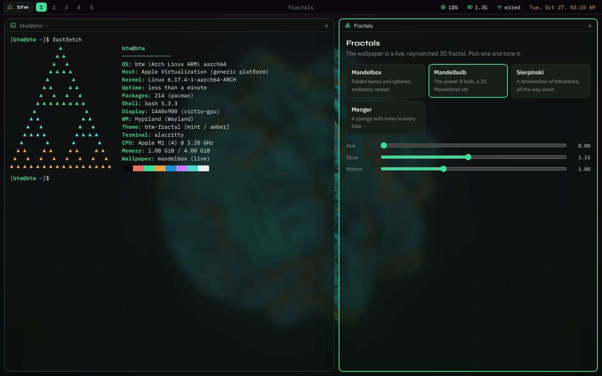
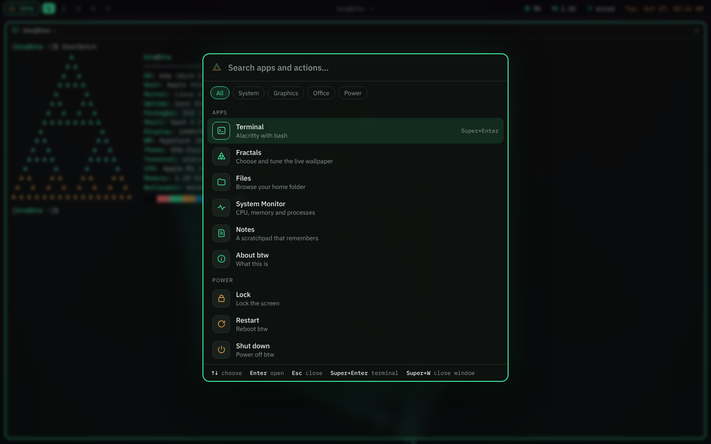

<h1 align="center">btw</h1>

<p align="center">
  <a href="https://github.com/noisyloop/btw/actions/workflows/build.yml"></a>
  <a href="https://github.com/noisyloop/btw/releases/latest"></a>
  
</p>

<p align="center"><b>A fractal-themed Linux desktop you can try on a Mac with one download.</b><br>
A native macOS launcher that boots btw in a VM on Apple silicon.</p>

<p align="center"><a href="https://github.com/noisyloop/btw/releases/latest/download/btw-macos.dmg"><b>Download for Mac</b></a> · <a href="https://github.com/noisyloop/btw/releases/latest/download/btw-factory.tar.gz"><b>btw disk image</b></a> · free and open source</p>

<p align="center"></p>

> Early days: btw boots into a basic desktop: Sway with the fractal theme, waybar,
> an app menu (<kbd>Cmd</kbd>+<kbd>Space</kbd>), a terminal (<kbd>Cmd</kbd>+<kbd>Enter</kbd>),
> Firefox, a file manager and an editor. Open **btw.app** and choose **Boot btw**: the
> first boot downloads the btw disk image once and copies it into your VM. Until the
> first release is out, get the dmg and `btw-factory.tar.gz` from **Artifacts** on the
> latest [Build run](https://github.com/noisyloop/btw/actions/workflows/build.yml), and
> choose the disk image when the app asks.

The current milestone is proving the hardest part: **booting a Linux VM from
Swift on an M1**. See [docs/PLAN.md](docs/PLAN.md) for the full roadmap.

## Desktop preview

Until the VM desktop is ready, `desktop/` is a preview of what it will look like. It runs in any
browser: open `desktop/index.html` (or `make preview`). It boots with a terminal open and
includes:

- **A live wallpaper:** a raymarched 3D fractal (mandelbox, mandelbulb, Sierpinski or Menger)
  that orbits slowly. Change it from the Fractals app or with `fractal list` in the terminal.
- **A terminal:** bash-like, with `fastfetch`, `ls`, `cd`, `cat`, `pacman -Syu` and more.
  Type `help` for the full list.
- **The app menu:** <kbd>Super</kbd>+<kbd>Space</kbd>, <kbd>Ctrl</kbd>+<kbd>Space</kbd> or the
  **btw** button. Search apps, filter by category, and lock, restart or shut down.
- **Tiling windows and keybindings, as in Omarchy:** <kbd>Super</kbd>+<kbd>Enter</kbd> opens a
  terminal, <kbd>Super</kbd>+<kbd>W</kbd> closes a window, and <kbd>Super</kbd>+<kbd>1</kbd>
  to <kbd>5</kbd> switch workspaces. <kbd>Alt</kbd> works in place of <kbd>Super</kbd> where
  the OS keeps that key.

<p align="center"></p>

The preview is laid out like an Omarchy desktop. The bar stands in for waybar, the menu for
walker, the tiling for Hyprland and the terminal for Alacritty. The palette lives in
`desktop/theme.css`, and the matching configs for the real desktop are in
`distro/themes/fractal/`, so either can become the GUI later.

## Build it yourself

No GitHub Actions needed: one script builds everything on your Mac and boots it.

```sh
git clone https://github.com/noisyloop/btw.git
cd btw
./build-local.sh          # app + disk image, then boot it (run it again later to update)
```

You need Apple's command line tools (the script offers to install them) and, for the disk
image, Docker Desktop or OrbStack running. `./build-local.sh app`, `image` or `boot` do one
step at a time.

## Requirements

- An Apple silicon Mac (M1 or newer) on macOS 13 Ventura or newer
- Xcode Command Line Tools (`xcode-select --install`) for `swift` and `codesign`

## Prove it boots

```sh
# 1. Headless: boots Debian's arm64 installer kernel with the console in your terminal.
#    ~40 MB download. Success = kernel log, then the installer's language menu.
#    Press Ctrl-] to stop the VM.
make smoke

# 2. Windowed: boots an arm64 installer ISO through UEFI in a native window with
#    virtio-gpu graphics, keyboard, mouse, sound, NAT networking and clipboard sharing.
#    ~700 MB download.
make gui
```

`make build` alone produces `app/.build/release/btw`, ad-hoc signed with the
`com.apple.security.virtualization` entitlement. Without that entitlement the
framework refuses to start a VM.

## Build and boot the btw factory disk

```sh
make image     # Docker (arm64): pacstrap Arch Linux ARM -> out/btw-factory.img (+ .tar.gz)
make factory   # clone it into a 32 GiB VM and boot it via EFI + systemd-boot
```

The factory disk is a GPT image: an ESP with systemd-boot, the kernel and the
initramfs (mounted at `/boot`), and an ext4 root that grows itself to fill
whatever disk size the launcher gives the VM. It logs in automatically as `btw`
(password `btw`; change it with `passwd`). On the VM's screen it starts the desktop;
the serial console and SSH stay plain shells. Packages are listed in
`distro/packages.txt`, and config files are overlaid from `distro/rootfs/`.

### The desktop

The VM has no GPU acceleration, so the desktop is [Sway](https://swaywm.org) rendering on
the CPU (Hyprland, as in Omarchy, needs a GPU and comes later). It uses the same fractal
palette as the browser preview. Inside the VM window, <kbd>Cmd</kbd> is the Super key:

| Keys | Action |
|---|---|
| <kbd>Cmd</kbd>+<kbd>Space</kbd> | App menu |
| <kbd>Cmd</kbd>+<kbd>Enter</kbd> | Terminal |
| <kbd>Cmd</kbd>+<kbd>B</kbd> / <kbd>Cmd</kbd>+<kbd>E</kbd> | Firefox / files |
| <kbd>Cmd</kbd>+<kbd>W</kbd> | Close window |
| <kbd>Cmd</kbd>+<kbd>1</kbd>…<kbd>5</kbd> | Switch workspace |
| <kbd>Cmd</kbd>+<kbd>Shift</kbd>+<kbd>E</kbd> | Exit to the console |

The config lives in `distro/rootfs/etc/sway/config` and `distro/rootfs/etc/xdg/`, and the
wallpaper and waybar style in `distro/themes/fractal/`.

On Linux (arm64 or x86-64 with QEMU installed), `make boot-test` boots the
built image in QEMU and checks that it logs in, grows its root and powers off.

## How it's built and released

Like [Fleet-51](https://github.com/noisyloop/Fleet-51), one GitHub Actions
workflow (`.github/workflows/build.yml`) does everything:

- **macOS app:** builds, signs and packages `btw-macos.dmg` on an Apple silicon
  runner, then checks its signature and entitlement. Hosted Mac runners can't
  run VMs inside themselves, so the launcher's boot test runs only where
  `btw check` passes.
- **Factory disk:** builds `btw-factory.img` on an arm64 Linux runner and
  boot-tests it in QEMU.
- **Release:** bump `CFBundleShortVersionString` in `app/Info.plist` and merge
  to main. CI then publishes `v<version>` with both files, and the download
  links above point to it.

## Package as an app

```sh
make dmg   # dist/btw.app and dist/btw-macos.dmg, ad-hoc signed
```

Drop a 1024×1024 `assets/AppIcon.png` in place to get an app icon. Double-clicking
`btw.app` asks whether to boot the existing VM or install from an ISO. The dmg is
ad-hoc signed, not notarized, so on another Mac you have to right-click the app
and choose Open the first time.

## Using the launcher directly

```sh
btw run --iso ~/Downloads/some-arm64.iso       # install from an ISO (EFI)
btw run                                         # boot the installed disk afterwards
btw run --headless --kernel Image --initrd initrd.gz --cmdline "console=hvc0 root=/dev/vda2"
btw run --share ~/code                          # in the guest: mount -t virtiofs btw /mnt/btw
btw --help
```

Each VM is a bundle in `~/Library/Application Support/btw/VMs/<name>/`
containing a sparse `disk.img`, EFI variables, a stable machine identifier and
`console.log` (the serial console in windowed mode). Delete the folder to start over.

If Rosetta for Linux is installed on the host (`softwareupdate --install-rosetta`),
it is exposed to the guest under the `rosetta` virtiofs tag, so x86-64 Linux
binaries can run in the arm64 guest.

## Layout

```
desktop/    browser preview of the btw desktop (temporary)
.github/    CI: build, test and release (dmg + disk image)
distro/     factory disk build: Dockerfile, build.sh, package list, rootfs overlay, themes/
app/        Swift package: the launcher (Virtualization.framework + AppKit), Info.plist, entitlements
assets/     art for the app (an AppIcon.png here becomes the app icon)
scripts/    fetch known-good test kernels/ISOs (checksum-verified), package the .app/.dmg, boot tests
docs/       plan and design notes
```
